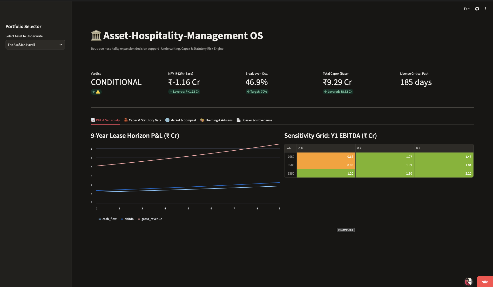

# Asset-Hospitality-Management

Acquisition and Underwriting OS for boutique hospitality assets.
Screen fast. Underwrite deep. Decide with evidence.

<p align="center">
  <a href="https://asset-hospitality-management-eflwbrd5jtd7yyydnwktr8.streamlit.app">
    
  </a>
</p>
Sample dossier: outputs/underwriting_dossier.md



Interactive underwriting dashboard. Switch assets in the sidebar to recalculate NPV, Capex,
break-even occupancy, and statutory risk in real time.

---

## Executive Summary

| Question | Engine answer |
|---|---|
| Should we lease this heritage property? | CONDITIONAL GO, lever-dependent |
| Where is the capital risk concentrated? | Telangana Fire NOC setback (8 ft actual vs 15 ft tender access) |
| Capital required | Rs 9.29 Cr base, Rs 8.33 Cr levered |
| Break-even occupancy | 46.9% vs 70% target, 23.1 points of margin |
| What converts it to a GO | 15% tourism capex subsidy, 6 rent-free months, theming-driven ADR push |

<details>
<summary>Why "conditional" is the honest verdict</summary>

Base-case NPV at a 12% hurdle is negative Rs 1.16 Cr. With three negotiated levers it becomes
positive Rs 1.73 Cr at a 16.7% IRR. The engine does not hide the gap. It prices exactly what must
be negotiated to close it, and ranks assets by levered NPV so the founding team can compare
deals on identical terms.

</details>

---

## Methodology

The engine operates in four stages:
Market indexing. Compset ADR and occupancy are averaged per asset and compared against the
target position to derive a RevPAR premium.
Capital stack. Hard Capex from the physical audit is rolled up with soft costs, a 10%
contingency, and working capital scaled by key count.
Statutory gate. Licensing requirements are evaluated for dealbreaker status and summed into
a critical-path duration.
Lease-horizon DCF. A 9-year P&L is built with revenue growth, rent escalation, OTA
commission, FF&E reserve, and 25% tax. NPV and IRR are computed against the 12% hurdle,
and the verdict is assigned by comparing base and levered cases.

## Tests

pytest -q

Five invariants lock the engine's mathematics:

Break-even occupancy is strictly below target occupancy

Total Capex is greater than hard Capex

Verdict is one of three engineered states

Levered NPV strictly improves base NPV

Seeded portfolio contains at least one statutory dealbreaker

## Quickstart

git clone https://github.com/srivastavnilesh/Asset-Hospitality-Management.git

cd Asset-Hospitality-Management

python3 -m venv .venv && source .venv/bin/activate

pip install -r requirements.txt

python src/data/generate_dataset.py

python src/analytics/underwriting_engine.py

python src/analytics/report_builder.py

python src/analytics/tableau_export.py

pytest -q

streamlit run app/streamlit_app.py

## Provenance

<details>
<summary>Methodology lineage</summary>

Statutory-gate logic, Capex contingency practice, and egress/setback checks are ported from the
SVNIT digital-twin audit engine, which governed a 9,478 sqm institutional asset. That engine
capped a physical grade of A (88/100) to B (83.9) for a lapsed Fire NOC, flagged a water
consumption of 201 LPCD against the IS 1172 norm of 135 with a 13-month payback on an Rs 85,000
retrofit, and identified a Rs 0 structural rectification by cross-referencing defects against an
active CPWD Clause 7.1 waterproofing bond.
The hospitality layer adds industry-standard unit economics: RevPAR compset indexing, OTA
commission load, FF&E reserve, rent escalation, and lease-horizon discounted cash flow at the
founder hurdle rate.

</details>


## Architecture

```mermaid
graph TD
    A[Seeded portfolio generator: 2 assets, 6 tables] --> B[(SQLite + CSV store)]
    B --> C[Underwriting engine: NPV, IRR, break-even, sensitivity, verdict]
    C --> D[Founder dossier, markdown]
    C --> E[Tableau-ready exports, 9 CSVs]
    C --> F[Streamlit decision dashboard]
    G[Pytest invariants, 5 tests] -. locks the maths .-> C
