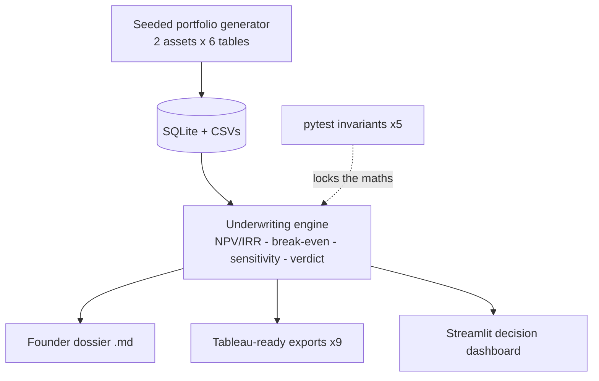

<div align="center">

# 🏛️ Asset-Hospitality-Management
### Acquisition & Underwriting OS for boutique hospitality assets
*Screen fast. Underwrite deep. Decide with evidence.*

[](STREAMLIT_URL)
[](tests/test_engine.py)
[](requirements.txt)
[](app/streamlit_app.py)

**[🖥️ Live Product Demo](STREAMLIT_URL)** • **[📊 Executive Tableau Dashboard](TABLEAU_URL)** • **[📄 Sample Dossier](outputs/underwriting_dossier.md)**

</div>

---

## 🧭 Navigation
- [⚡ 60-Second Summary](#-60-second-summary)
- [🏗️ Architecture](#️-architecture)
- [🧮 Engine Outputs (committed log)](#-engine-outputs-committed-log)
- [🧪 Tests](#-tests)
- [🚀 Quickstart](#-quickstart)
- [🏛️ Provenance](#️-provenance-module-0)

---

## ⚡ 60-Second Summary
| Question | Engine's answer |
|---|---|
| Should we lease this heritage property? | **CONDITIONAL GO** — lever-dependent |
| Where's the money pit? | Telangana Fire NOC setback (8 ft vs 15 ft tender access) |
| Capital required? | ₹9.29 Cr base → ₹8.33 Cr levered |
| Break-even? | 46.9% occupancy vs 70% target = 23.1 pts margin of safety |
| What flips it to GO? | 15% tourism subsidy + 6 rent-free months + theming-driven ADR push |

<details>
<summary>🎯 <b>Click: why "conditional" is the honest verdict</b></summary>
Base-case NPV @12% is <b>−₹1.16 Cr</b>. With three negotiated levers it becomes <b>+₹1.73 Cr (IRR 16.7%)</b>.
The engine doesn't hide the gap — it prices exactly what must be negotiated to close it.
</details>

## 🏗️ Architecture


## 🧮 Engine Outputs (committed log)
<details>
<summary>📜 <b>Click: latest portfolio run</b></summary>

| Rank | Asset | Verdict | NPV base | NPV levered | IRR lev. | Capex | Break-even |
|---|---|---|---|---|---|---|---|
| 1 | HYD-OLD-001 Asaf Jah Haveli | CONDITIONAL GO | −₹1.16 Cr | +₹1.73 Cr | 16.7% | ₹9.29 Cr | 46.9% |
| 2 | GOA-VIL-002 Casa Fontainhas | CONDITIONAL GO | −₹1.57 Cr | +₹0.50 Cr | 14.0% | ₹6.50 Cr | 52.0% |

Full terminal logs: [`outputs/logs/`](outputs/logs) — every run is committed, auditable, reproducible.
</details>

## 🧪 Tests
```bash
pytest -q   # 5 passed: break-even, capex rollup, verdict domain, lever monotonicity, statutory gate
```

## 🚀 Quickstart
```bash
pip install -r requirements.txt
python src/data/generate_dataset.py
python src/analytics/underwriting_engine.py
python src/analytics/report_builder.py
python src/analytics/tableau_export.py
pytest -q
streamlit run app/streamlit_app.py
```

## 🏛️ Provenance (Module 0)
<details>
<summary>🔬 <b>Click: methodology lineage</b></summary>
Statutory-gate logic, capex contingency practice and egress/setback checks ported from the
<b>SVNIT digital-twin audit engine</b> (BHI 83.9 governance-capped for lapsed Fire NOC; IS 1172 norm
135 LPCD vs measured 201; NBC 2016 egress; CPWD Cl. 7.1 guarantee leverage). Hospitality layer adds
RevPAR compset indexing, OTA commission load, FF&E reserve and lease-horizon DCF at founder hurdle.
</details>

---
<div align="center">
<b>Built by Nilesh Srivastav</b> — Civil Engineering × Data Science<br/>
<i>Every engine ships with committed logs, tests, and a live dashboard.</i>
</div>